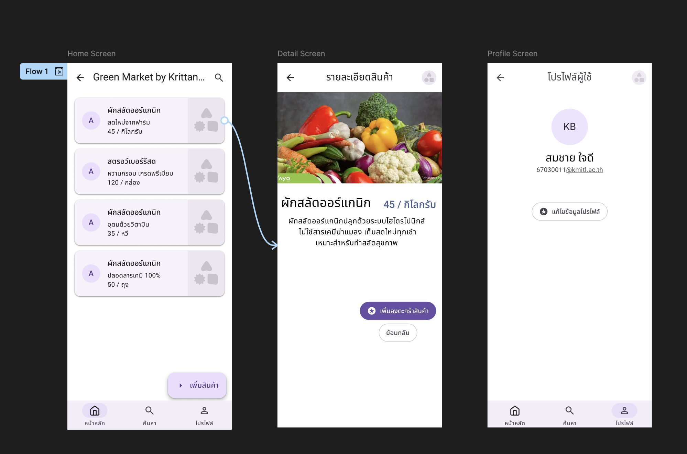
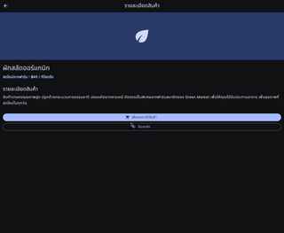

# Green Market App - UI/UX Design & Flutter Implementation

---

## ผลการทดลองที่ 2 Figma UI Design & Prototype

  

---

## ผลการทดลองที่ 3 แปลง Design เป็น Flutter Code

ภาพเคลื่อนไหวผลการทดสอบการทำงานของแอปพลิเคชันจริงบน Web Simulator แสดงการนำทางระหว่างหน้าจอ (Navigation) และฟังก์ชันต่าง ๆ

  

---

## ผลการทดลองที่ 4 การวิเคราะห์โค้ดจาก AI Studio

### คำถามข้อที่ 4.3 วิเคราะห์ Code ที่สร้างจาก AI

* **AI ใช้ Widget อะไรสร้าง Avatar?**
  * `CircleAvatar`
* **AI handle กรณี avatarUrl เป็น null อย่างไร?**
  * ใช้ Ternary operator ตรวจสอบเงื่อนไข โดยแสดงตัวอักษรย่อ (`Text(_initials)`) บนพื้นหลังสี `colorScheme.primaryContainer` แทนกรณีไม่มีรูปภาพ
* **AI ใช้ color จาก Theme หรือ hardcode?**
  * ดึงค่าสีจากระบบธีม (`Theme.of(context).colorScheme`) ทั้งหมด ไร้การ hardcode รหัสสี
* **มีส่วนไหนที่ควรปรับปรุง?**
  * ปุ่ม Follow และ Message มีการเขียน `onPressed () {}` แบบฟิกซ์ฟังก์ชันว่าง ควรเปิดให้รับ callback ผ่าน Constructor และควรจัดการกรณีการโหลดภาพแตกบน `NetworkImage` ด้วยการใส่ loading/error state

### คำถามข้อที่ 4.5 ผลการเปรียบเทียบโค้ด AI (Multimodal) กับโค้ดที่เขียนขึ้นเอง

1. **โครงสร้าง Widget Tree**
   * โค้ดที่เขียนเองในการทดลองที่ 3 แยกส่วนเนื้อหา (ListView) และ NavigationBar ออกจากกัน และเรียกใช้ ItemCard ที่เป็น Reusable Widget
   * โค้ดที่ AI สร้างเป็นการวิเคราะห์หน้าจอเดี่ยว (ProfileScreen) ที่มี Scaffold, AppBar, Column กลางที่มี CircleAvatar และ OutlinedButton.icon ซึ่งตรงกับความต้องการของ Figma
2. **การเรียกใช้สีและฟอนต์ (Material 3 Theme)**
   * ทั้งสองแบบไม่มีการฮาร์ดโค้ดรหัสสี (Hex Color) โดยใช้ Theme.of(context).colorScheme และ Theme.of(context).textTheme ทำให้ระบบเปลี่ยนธีม Light/Dark ได้โดยอัตโนมัติ
3. **ข้อดีของโค้ดที่ AI สร้าง**
   * AI สามารถสร้าง UI Layout ได้รวดเร็วและใช้ Component Material 3 ที่ถูกต้อง เช่น NavigationBar, OutlinedButton.icon ได้สวยงาม
4. **ข้อจำกัดของโค้ดที่ AI สร้าง**
   * มีการฮาร์ดโค้ดค่าบางจุด เช่น รหัสนักศึกษาและชื่อ "สมชาย ใจดี" และไม่มีพารามิเตอร์ส่งผ่าน Constructor ทำให้ไม่สามารถเป็น Reusable Widget ได้ดีเท่าตัวที่เขียนเอง และไม่มี callback ฟังก์ชันตอบสนองการกดปุ่ม

---

## คำถามสรุปการเรียนรู้

**ข้อ 1** Material 3 ต่างจาก Material 2 อย่างไรในด้าน Color System?
> Material 3 ใช้ระบบสีแบบไดนามิกที่คำนวณจากสีเริ่มต้นเพียงสีเดียว ทำให้ได้โทนสีที่เข้ากันอย่างอัตโนมัติผ่าน Tonal Palettes โดยแบ่งสีเป็นกลุ่มสำหรับ Container และ On-container ต่างจาก Material 2 ที่ใช้สีแบบตายตัวและเน้นเพียงสีหลักกับสีรองเท่านั้น

**ข้อ 2** เมื่อแปลง Figma Design เป็น Flutter Widget พบปัญหาอะไรบ้าง และแก้ไขอย่างไร?
> พบปัญหาเรื่องความแตกต่างของการตั้งค่าสีพื้นหลังและขนาดของตัวอักษรบางส่วนรวมถึงการใช้คุณสมบัติที่ล้าสมัยของธีม วิธีแก้ไขคือปรับแต่งค่า Theme ของโปรเจกต์ให้สอดคล้องกับ Figma และใช้คุณสมบัติใหม่ของระบบ Material 3 เช่น การใช้สีของ surface แทนคำสั่ง background ที่ยกเลิกไปแล้ว

**ข้อ 3** Code ที่ AI สร้างให้นั้นสมบูรณ์แค่ไหน? ต้องปรับปรุงอะไรบ้าง?
> โค้ดที่ AI สร้างมีความสมบูรณ์ในการจัดโครงสร้างหน้าตาแอปและใช้โทนสีจากระบบธีมได้อย่างถูกต้องแต่ยังมีข้อจำกัดที่จำเป็นต้องปรับปรุงเพิ่มเติมนั่นคือการรับค่าต่าง ๆ ผ่านตัวรับข้อมูลของคลาสและสร้างส่วนตอบสนองเมื่อผู้ใช้กดปุ่มแทนการปล่อยให้เป็นฟังก์ชันว่างเปล่า

**ข้อ 4** ถ้าจะนำ UI ที่ออกแบบไปใช้กับ Project จริง จะปรับปรุงอะไรบ้าง?
> หากจะนำไปใช้ในงานจริงควรปรับปรุงโดยการเชื่อมต่อระบบจัดการสภาพแวดล้อมและจัดการสถานะของแอปเพื่อความเสถียร ใช้ไลบรารีเพื่อเพิ่มประสิทธิภาพการโหลดและเก็บแคชรูปภาพจากอินเทอร์เน็ตเพื่อป้องกันรูปภาพไม่แสดงผล รวมทั้งการแยกส่วน UI ออกมาเป็น Widget ย่อยเพื่อให้สามารถนำกลับมาใช้ซ้ำได้ง่ายในอนาคต
