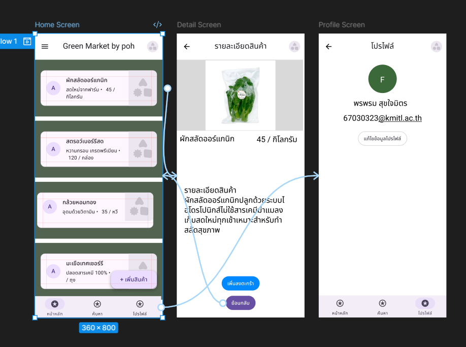
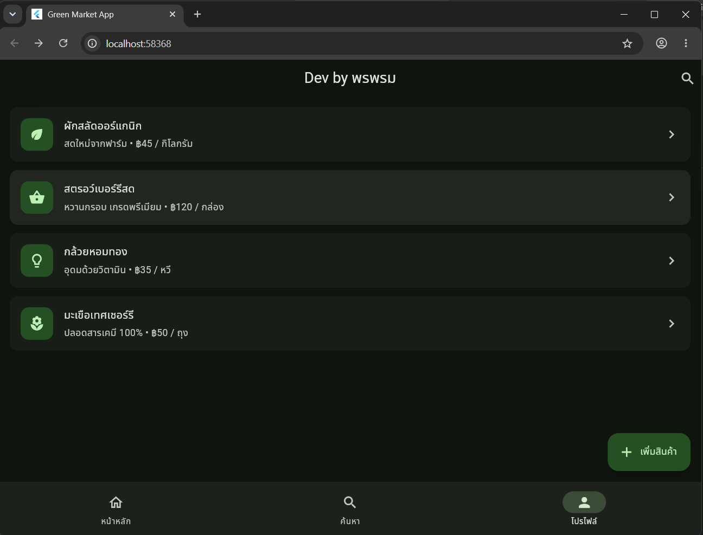

# 📱 รายงานการทดลองสัปดาห์ที่ 3: Mobile UI (Material Design 3 & Flutter)

**จัดทำโดย:** พรพรม สุขใจมิตร (67030323)

---

## 📑 สารบัญภาพรวม
1. [การทดลองที่ 1: สร้าง Color Scheme ด้วย Material Theme Builder](#-การทดลองที่-1-สร้าง-color-scheme-ด้วย-material-theme-builder)
2. [การทดลองที่ 2: ออกแบบ UI Mockup ด้วย Figma](#-การทดลองที่-2-ออกแบบ-ui-mockup-ด้วย-figma)
3. [การทดลองที่ 3: แปลง Design เป็น Flutter Code](#-การทดลองที่-3-แปลง-design-เป็น-flutter-code)
4. [การทดลองที่ 4: ใช้ AI ช่วย Generate UI Component](#-การทดลองที่-4-ใช้-ai-ช่วย-generate-ui-component)
5. [การทดลองที่ 5: Dark Mode และ Accessibility Check](#-การทดลองที่-5-dark-mode-และ-accessibility-check)
6. [คำถามสรุปการเรียนรู้](#-คำถามสรุปการเรียนรู้)

---

## 🎨 การทดลองที่ 1: สร้าง Color Scheme ด้วย Material Theme Builder

**วัตถุประสงค์:** ใช้ระบบ Dynamic Color ของ Material 3 เพื่อสร้าง Color Scheme สำหรับ Project 

### 📊 บันทึกผลการทดลอง
*(ตัวอย่างโทนสีที่เลือก)*

| รายการ | ค่าที่ได้ (Hex) |
|--------|---------|
| Primary Color | `#196c2e` |
| Secondary Color | `#52634f` |
| Primary Container | `#a4f5a9` |
| Surface | `#f7fbf1` |

### 🔍 วิเคราะห์ความสัมพันธ์ของสี

| สี | หน้าที่และความสัมพันธ์ |
|-----|--------|
| **Primary** | สีหลักของแอปพลิเคชัน ใช้กับองค์ประกอบที่สำคัญที่สุด เช่น ปุ่มหลัก หรือแถบสถานะ |
| **On Primary** | สีของข้อความหรือไอคอนที่วางบนพื้นสี Primary มีความเปรียบต่างสูงเพื่อให้อ่านง่าย |
| **Primary Container** | สีพื้นหลังที่ลดทอนความเข้มลงมาจาก Primary ใช้เน้นพื้นที่ที่มีความสำคัญรองลงมา |
| **On Primary Container**| สีของข้อความหรือไอคอนที่วางบน Primary Container มักเป็นสีโทนเดียวกับ Primary แต่เข้มจัด |

---

## 📐 การทดลองที่ 2: ออกแบบ UI Mockup ด้วย Figma

**วัตถุประสงค์:** สร้าง Mockup ของ Mobile App 3 หน้าด้วย Material Design 3

### 🖼️ ภาพรวม Design และ Prototype
ออกแบบหน้าจอ Home, Detail และ Profile พร้อมเชื่อมโยง Prototype การทำงาน

---

## 💻 การทดลองที่ 3: แปลง Design เป็น Flutter Code

**วัตถุประสงค์:** เขียน Flutter Widget จาก Design แอปพลิเคชัน "Green Market"

### ✅ ผลการตรวจสอบความถูกต้อง
- [x] App Bar แสดงชื่อ "Dev by พรพรหม"
- [x] แสดงรายการสินค้า Card ทั้ง 4 รายการถูกต้อง
- [x] กด Card สินค้าแล้ว Navigate ไปยัง Detail Screen ได้
- [x] กด Back / ปุ่มย้อนกลับได้ถูกต้อง
- [x] Bottom Navigation สลับ Tab ได้
- [x] FAB แสดง SnackBar เมื่อถูกคลิก

### 🖼️ ภาพผลลัพธ์จากการรันแอปพลิเคชัน

---

## 🤖 การทดลองที่ 4: ใช้ AI ช่วย Generate UI Component

**วัตถุประสงค์:** ฝึกใช้ Google AI Studio สร้าง Flutter Widget และวิเคราะห์โครงสร้าง UI

### 🔍 วิเคราะห์ Code ที่ AI สร้างให้

| คำถาม | คำตอบ |
|-------|-------|
| **AI ใช้ Widget อะไรสร้าง Avatar?** | ใช้ `CircleAvatar` ในการสร้างพื้นที่วงกลม และแสดงรูปภาพด้วย `NetworkImage` |
| **AI handle กรณี avatarUrl เป็น null อย่างไร?** | ใช้การเช็คเงื่อนไข `(avatarUrl == null \|\| avatarUrl!.isEmpty)` หากเป็นค่าว่างจะใช้ `Text` แสดงตัวอักษรย่อของชื่อแทน |
| **AI ใช้ color จาก Theme หรือ hardcode?** | อ่านค่าจาก Theme ทั้งหมด เช่น `colorScheme.primaryContainer` โดยไม่ใช้การ Hardcode สี |
| **มีส่วนไหนที่ควรปรับปรุง?** | โค้ดสมบูรณ์ดี แต่อาจเพิ่มการจัดการ Error ให้กับ `NetworkImage` กรณีที่ URL ถูกต้องแต่โหลดรูปไม่สำเร็จเพื่อป้องกันแอปแครช |

### 🧠 ผลการเปรียบเทียบ Widget Tree (มนุษย์ VS AI)
* **โครงสร้างหลัก:** มองตรงกันว่าใช้ `Scaffold`, `AppBar` และ `bottomNavigationBar`
* **การจัดการ Body:** มนุษย์ดึง `ItemCard` แยกเป็น Custom Widget ชิ้นเดียวเพื่อให้โค้ดเป็นระเบียบ แต่ AI แตกโครงสร้างภายใน Card ออกมาละเอียดยิบย่อย ทำให้ไฟล์หลักยาวเกินไป
* **การจัดวางปุ่ม FAB:** มนุษย์ใช้ Property `floatingActionButton` ของ Scaffold ตามมาตรฐาน แต่ AI มองภาพ 2 มิติเป็นปุ่มวางซ้อน จึงเลือกใช้ `Stack` ร่วมกับ `Positioned` ซึ่งไม่ใช่ Best Practice

---

## 👁️ การทดลองที่ 5: Dark Mode และ Accessibility Check

**วัตถุประสงค์:** ทดสอบว่า UI ทำงานได้ดีทั้ง Light/Dark Mode และผ่าน Accessibility

*   **ทดสอบ Dark Mode:** โทนสี Dark Mode สามารถอ่านได้ชัดเจน (Readability ดี) เนื่องจากระบบ ColorScheme ของ Material 3 คำนวณค่าความเปรียบต่างมาให้อย่างเหมาะสม ตัวหนังสือไม่กลืนไปกับพื้นหลัง
*   **ทดสอบ Touch Target Size:** จากการเปิด Show guidelines พบว่า Interactive elements เช่น IconButton มีการจองพื้นที่อย่างน้อย 48x48 dp ตามมาตรฐาน Material 3 ทำให้ผู้ใช้สัมผัสใช้งานได้ง่าย
*   **ตรวจสอบ Semantic Labels:** แอปพลิเคชันมีการใช้ `tooltip` และ `label` กำกับปุ่มต่างๆ ครบถ้วน ช่วยให้ระบบ Screen Reader (เช่น TalkBack/VoiceOver) สามารถอ่านบรรยายหน้าที่ของปุ่มให้ผู้บกพร่องทางการมองเห็นเข้าใจได้

---

## 📝 คำถามสรุปการเรียนรู้

**ข้อ 1: Material 3 ต่างจาก Material 2 อย่างไรในด้าน Color System?**
> **คำตอบ:** Material 3 มีระบบ Dynamic Color และ Tonal Palettes โดยเมื่อกำหนดสีหลักเพียงสีเดียว ระบบจะคำนวณเฉดสีอื่นๆ ให้อัตโนมัติเพื่อให้ได้ชุดสีที่เข้ากันและมี Contrast ที่เหมาะสมทั้งโหมด Light/Dark ต่างจาก Material 2 ที่ต้องกำหนดค่าเองแบบ Manual

**ข้อ 2: เมื่อแปลง Figma Design เป็น Flutter Widget พบปัญหาอะไรบ้าง และแก้ไขอย่างไร?**
> **คำตอบ:** ปัญหาหลักคือการจัดระยะห่าง (Spacing) และสัดส่วนหน้าจอ ใน Figma ใช้ Auto Layout ได้ง่าย แต่ใน Flutter ต้องประยุกต์ใช้ `Row`, `Column`, `Padding` และ `SizedBox` แก้ไขโดยการวิเคราะห์ Widget Tree ให้ชัดเจนก่อน และใช้ `Expanded` หรือ `Flexible` เพื่อป้องกันปัญหาหน้าจอล้น (Overflow)

**ข้อ 3: Code ที่ AI สร้างให้นั้นสมบูรณ์แค่ไหน? ต้องปรับปรุงอะไรบ้าง?**
> **คำตอบ:** โค้ดสมบูรณ์ในแง่ Syntax และการเรียกใช้ Theme แต่ควรปรับปรุงเรื่องการจัดการข้อผิดพลาด (Error Handling) เช่น กรณีโหลดรูปไม่ขึ้น และปรับปรุงโครงสร้างบางอย่างให้ตรงตาม Best Practice ของ Flutter เช่น การใช้ `floatingActionButton` แทนการใช้ `Stack` ทับซ้อนกัน

**ข้อ 4: ถ้าจะนำ UI ที่ออกแบบไปใช้กับ Project จริง จะปรับปรุงอะไรบ้าง?**
> **คำตอบ:** 1. นำ State Management (เช่น Provider) มาใช้เพื่อจัดการข้อมูลตะกร้าสินค้า 2. เปลี่ยนจาก Hardcode เป็นการดึงข้อมูลจาก API หรือ Database จริง 3. ปรับโครงสร้าง UI ให้เป็น Responsive เพื่อรองรับหน้าจอที่หลากหลายทั้งมือถือและแท็บเล็ต
