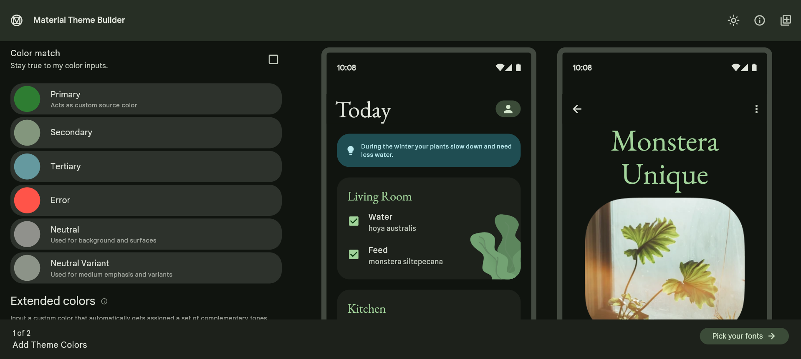
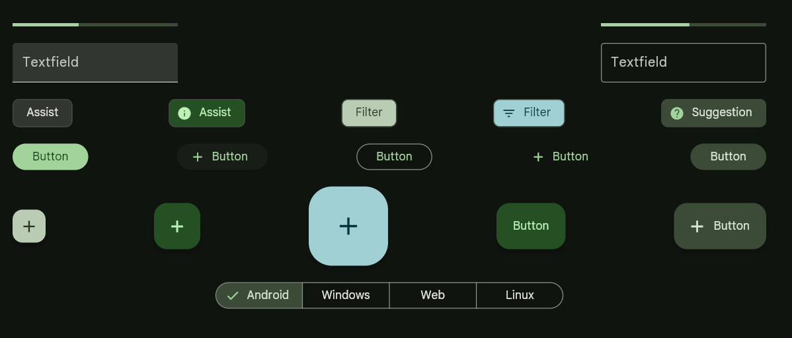
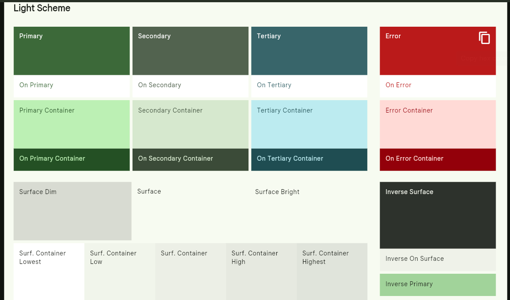

## 🧪 การทดลองที่ 1: สร้าง Color Scheme ด้วย Material Theme Builder

### วัตถุประสงค์
ใช้ระบบ Dynamic Color ของ Material 3 เพื่อสร้าง Color Scheme สำหรับ Project 

### ขั้นตอน

**ขั้นตอนที่ 1.1: เปิด Material Theme Builder**
1. เปิด Browser ไปที่ https://m3.material.io/theme-builder
2. จะเห็น UI Preview ของ Material 3 App พร้อม Color Picker

**ขั้นตอนที่ 1.2: สร้าง Color Scheme ของตัวเอง**
1. คลิกที่ **"Primary"** color circle
2. เลือกสีที่เป็น brand color ของ App ที่จะทำ Project
3. สังเกตว่า Secondary, Tertiary, Neutral **เปลี่ยนอัตโนมัติ** ตาม Primary ที่เลือก
4. ทดลองสลับดูระหว่าง **Light** และ **Dark** mode สังเกตว่า contrast ยังชัดเจน

**ขั้นตอนที่ 1.3: Export เป็น Flutter Code**
1. คลิก **"Export"** ที่มุมขวาบน (ไอคอน สี่เหลี่ยม มีเครื่องหมาย + ตรงกลาง)
2. เลือก **"Flutter"**
3. จะได้ไฟล์ `lib/theme.dart` ที่มี `ColorScheme` สำหรับ Light และ Dark

---

### 📊 บันทึกผลการทดลอง (ขั้นตอนที่ 1.4)

| รายการ | ค่าที่ได้ |
|--------|---------|
| Primary Color (Hex) | #3c6939 |
| Secondary Color (Hex) | #52634f |
| Primary Container (Hex) | #bcf0b4 |
| Surface (Hex) | #f7fbf1 |

> **คำถาม:** Primary, On Primary, Primary Container, On Primary Container คืออะไร มีลักษณะความสัมพันธ์ของสีอย่างไร?  วิเคราะห์และเติมตารางด้านล่าง

| สี | หน้าที่ |
|-----|--------|
| Primary | สีหลักของแอปพลิเคชัน ใช้กับองค์ประกอบที่สำคัญที่สุดที่ต้องการให้ผู้ใช้สนใจ เช่น ปุ่มหลัก , Floating Action Button  หรือแถบสถานะ |
| On Primary | สีของข้อความหรือไอคอน ที่ต้องวางอยู่บนพื้นหลังสี Primary ออกแบบมาให้มี Contrast ตัดกันชัดเจน เพื่อให้อ่านง่าย |
| Primary Container | สีพื้นหลังที่ถูกลดทอนความเข้มลงมาจากสี Primary ใช้สำหรับเน้นพื้นที่หรือ Card ที่มีความสำคัญรองลงมา แต่ยังคงต้องการให้คลุมโทนสีหลักของแอป |
| On Primary Container | สีของข้อความหรือไอคอน ที่ต้องวางอยู่บนพื้นหลัง Primary Container เพื่อให้อ่านออกชัดเจนบนพื้นสีอ่อน |

## รูปภาพธีม

---
[⬅️ ย้อนกลับไปหน้าหลัก (สารบัญ)](README.md)